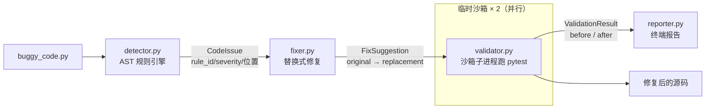

# CodeFix Agent · 找 Bug、改 Bug、用测试证明改对了

> 一个演示「检测 → 修复 → 验证 → 报告」闭环的代码修复 Agent。
> 输入一个藏着折扣计算 Bug 的订单模块，输出**改好的代码 + 修前 0/4、修后 4/4 的测试证据**。

```bash
$ python run_demo.py
====================================================================
  CodeFix Agent 报告 · demo_data/buggy_code.py
====================================================================
  检测到 1 个问题
    [CRITICAL] CF001  L16  折扣率 discount_rate 被当作折后系数直接相乘

  修复建议 1 条
    L16  把折扣率改为折后系数：discount_rate → (1 - discount_rate)
          subtotal * discount_rate
       →  subtotal * (1 - discount_rate)
          置信度 0.95

  验证（修复前）: 0/4 通过     耗时 1600ms
  验证（修复后）: 4/4 通过     耗时 1515ms

  结论：已套用 1/1 条修复，测试全绿 ✓
  总耗时: 1.62s
====================================================================
```

---

## 1. 被修掉的那个 Bug 长什么样

```python
subtotal = unit_price * quantity
total = subtotal * discount_rate      # ← Bug
```

`discount_rate = 0.1` 本意是"优惠 10%"（九折），这行算出来的却是原价的**一成**。
更糟的是 `discount_rate = 0.0`（不打折）时直接算出 **0 元**——折扣越常见的场景亏得越狠，
而且这个 Bug 不会抛异常、不会报错，只会在财务报表上安静地少钱。

修法只有一种、且确定：

```python
total = subtotal * (1 - discount_rate)   # 折扣率 → 折后系数
```

正因为它唯一确定，才是本项目中**唯一开放自动修复**的规则。

## 2. 架构



| 层 | 文件 | 职责 | 关键设计 |
|---|---|---|---|
| 模型层 | `src/models/issue.py`、`fix.py` | `CodeIssue` / `FixSuggestion` / `ValidationResult` / `FixReport` | 层间只传 Pydantic 模型，报告层不碰 AST |
| 检测层 | `src/detector.py` | AST 规则引擎，4 条规则 | 只报"能给出确定修复"的问题 |
| 修复层 | `src/fixer.py` | 生成并套用文本替换 | 按行倒序套用，改完强制 `ast.parse` 校验 |
| 验证层 | `src/validator.py` | 子进程跑 pytest | 独立沙箱，隔离 `sys.modules` 污染 |
| 报告层 | `src/reporter.py` | 终端报告 / dict 导出 | 纯文本，零表格库依赖 |
| 编排层 | `src/agent.py` | 五步一条链 | before/after 两个沙箱**并行**跑 |

### 规则集

| 规则 | 类别 | 严重度 | 检测方式 | 自动修复 |
|---|---|---|---|---|
| `CF001` | 折扣计算 | critical | `BinOp(Mult)` 直接操作数是"率"型变量名 | ✅ |
| `CF002` | 可变默认参数 | high | `FunctionDef` 默认值含 `List/Dict/Set` 字面量 | ❌ 只给建议 |
| `CF003` | 裸 except | medium | `ExceptHandler.type is None` | ❌ 只给建议 |
| `CF004` | 浮点相等 | medium | `Compare` 含 `Eq` 且操作数名像金额 / 比率 | ❌ 只给建议 |

只有 CF001 支持自动修复，这是刻意的：CF002 该用什么默认值、CF003 该记什么日志、
CF004 该用 `Decimal` 还是 `isclose`，都取决于上下文，硬套模板只会制造新 Bug。
**能确定的才自动改，不确定的只提示**——这条线比多修几个 Bug 更重要。

## 3. 三个容易踩的实现细节

**① 检测规则要防误报，`discounted` 不是 `discount`**

第一版规则用 `re.search(r"discount", name)` 匹配变量名，结果把
`discounted * (1 + TAX_RATE)` 也报成了折扣 Bug——`discounted` 是算完之后的结果值，
拿它做乘法完全正常。真正的修法是加一层排除：以 `ed` 结尾、或带 `_amount/_price/_value`
后缀的派生变量一律跳过。静态分析工具的可用性，取决于它**不报**什么。

```python
PRECOMPUTED_PATTERN = re.compile(r"(factor|multiplier|ratio|coef)", re.I)  # 已是系数
DERIVED_PATTERN = re.compile(r"(ed$|_amount|_price|_value|_total|_base)", re.I)  # 已是结果
```

**② 验证必须开子进程，不能在同一个解释器里跑**

同进程调 `pytest.main()` 会命中 `sys.modules` 里缓存的旧模块——修好的 `buggy_code`
可能根本没被重新导入，于是出现"修完了还是红"的假阴性。沙箱子进程每次都是干净解释器，
这类幽灵问题不存在。代价是多一次进程启动，所以又把两个沙箱**并行**跑，把总耗时压回 1.6s。

**③ 改完代码要能解析**

`fixer.apply()` 最后一步是 `ast.parse(fixed)`。语法都错了的"修复"比不修更糟，
宁可原样返回让测试报红。

## 4. 快速开始

```bash
cd codefix-agent
python -m pip install -r requirements.txt

python -m pytest tests/ -v   # 11 个用例
python run_demo.py           # 端到端演示，约 1.6s
```

### 修自己的文件

需要一个测试文件作为"验收标准"，Agent 会用它证明修复有效：

```python
from src.agent import CodeFixAgent

agent = CodeFixAgent()
report = agent.repair_file(
    "demo_data/buggy_code.py",
    test_files={"test_order_pricing.py": open("demo_data/test_order_pricing.py").read()},
)
print(agent.reporter.render(report))
print(report.fixed_source)   # 可以直接写回文件
```

## 5. 面试常见问题

**Q1：为什么只做规则引擎，不用 LLM 来修 Bug？**
三个理由。① **验证闭环不需要 LLM**：这个项目真正值钱的部分是"改完跑测试证明改对了"，
LLM 在这里是可选件；② **确定性**：同一个 Bug 必须每次得到同一个修复，LLM 做不到，
修 Bug 这种改生产代码的场景容错率极低；③ **可解释**：规则命中后能说清"为什么这行错了、
正确写法为什么是它"，LLM 给的 diff 往往要人再 review 一遍——那还不如直接 review 原 Bug。
LLM 合适的位置是规则命中 UNKNOWN 之后的兜底建议，那属于"给人看"，不属于"自动改"。

**Q2：静态检测最大的难点是什么？**
不是"找 Bug"，是"**不误报**"。第一版实现就把 `discounted * (1 + TAX)` 误判成折扣 Bug
（`discounted` 里含 `discount`），修好 4 个测试里的 3 个就卡住了——因为那次"修复"改坏了
正常代码。这个坑让我把规则从"名字像折扣"收紧成三条排除（已预计算的系数、派生结果值、
金额后缀），并把误报场景固化成了两个测试用例（`test_ignores_precomputed_multiplier`、
`test_ignores_derived_discount_value`）。**一个会误报的 linter 活不过一周**。

**Q3：验证为什么要用子进程 + 两个沙箱？**
子进程是为了隔离 `sys.modules`：同进程跑 pytest 会复用已导入的模块对象，
修复后的源码可能根本没生效，产生假阴性。两个沙箱是为了让 before/after 互不覆盖——
如果复用一个目录，先写修复前、再写修复后，第一次的结果就被覆盖了，
最后你拿到的"修复前 4/4 通过"其实是修复后的结果，整个演示就变成了自欺欺人。
两个沙箱用 `ThreadPoolExecutor` 并行，总耗时只比单趟多一点点（1.6s vs 1.0s）。

**Q4：11 个测试怎么分的？**
Detector 5、Fixer 2、Validator 2、Reporter 1、Integration 1。
其中 Detector 的 5 个里有 2 个是**反向用例**（不该报的没报），因为误报才是这类工具的真实风险；
Validator 的 2 个靠一个 module 级 fixture 共用两次 pytest 结果，避免同一份代码重复跑 4 遍；
Integration 那 1 个走完整链路，断言 `fixed_all` 为真——它同时覆盖了"检出→修复→测试变绿→结论正确"。

**Q5：这个项目和真正的自动修 Bug（如 SWE-bench 上的方案）差多远？**
差在**问题空间**。这里做的是"模式已知、修法唯一"的确定性缺陷，
真实仓库里的 Bug 需要理解跨文件调用、隐式契约和业务语义，规则引擎覆盖不了。
但它演示了完整闭环的形状：**检测要可解释、修复要可验证、不确定就不要动**——
换成 LLM 生成补丁时，这三条约束依然成立，只是"生成"那一环换了实现。

## 6. 已知限制

- 规则集只有 4 条，且 CF001 的判定依赖变量命名（`apply_discount(p, q, r)` 这种
  参数名不带 discount 的写法检测不到）。
- 修复采用**行内文本替换**，多行表达式或同一行多处命中只处理第一处。
- 没有做数据流分析：`rate = get_rate(); total = subtotal * rate` 这种间接写法漏报。
- 验证依赖被测模块能被测试文件直接 import，不支持需要复杂 fixture / 外部依赖的项目。
- 只跑一次测试，不做 flaky 重试。

## 7. 目录

```
codefix-agent/
├── README.md
├── requirements.txt
├── run_demo.py                    # 端到端演示（约 1.6s）
├── demo_data/
│   ├── buggy_code.py              # 含折扣 Bug 的订单模块
│   └── test_order_pricing.py      # 4 个验收测试
├── src/
│   ├── models/{issue,fix}.py
│   ├── detector.py                # AST 规则引擎
│   ├── fixer.py                   # 修复建议 + 套用
│   ├── validator.py               # 沙箱跑 pytest
│   ├── reporter.py                # 报告
│   └── agent.py                   # 编排
└── tests/test_codefix.py          # 11 个用例
```

---

技术栈：Python 3.13 · AST · Pydantic v2 · Pytest · subprocess 沙箱
